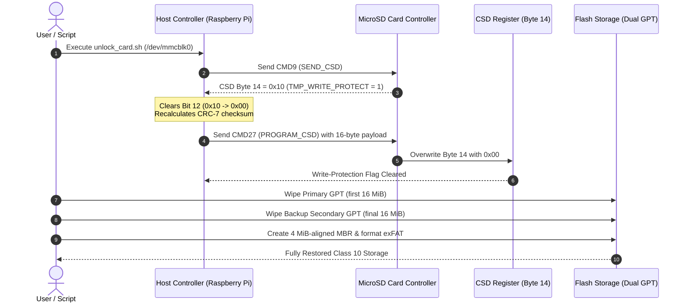

# MicroSD Hardware Unlocker: Salvaging Locked OEM Cards

[](https://opensource.org/licenses/MIT)
[](#)
[-blue.svg)](#)
[-orange.svg)](#)

A hardware recovery toolkit to remove electronic write-protection (`TMP_WRITE_PROTECT`) from locked OEM and educational MicroSD cards (BYJU'S, Aakash, Allen).

Bypasses USB bridge limitations and MediaTek driver FIFO bugs by using direct MMC bus commands (`CMD27`) on a native host controller, wiping hidden backup GPT tables, and formatting clean Class 10 storage.

---

## ⚡ Quick Start

### 1. Requirements
* A host with a **native MMC/SD controller** (`/dev/mmcblk0`). A **Raspberry Pi 3B+, 4, or Zero 2W** booted from a USB pendrive is the recommended universal host.
* Target locked MicroSD card (64 GB, 128 GB, or 256 GB).

### 2. Run Automated Recovery
1. Boot the Raspberry Pi from USB with the onboard MicroSD slot empty.
2. Insert the locked card into the Pi's native slot (`/dev/mmcblk0`).
3. Run the automated unlock script:
   ```bash
   git clone https://github.com/rendlavenu/sdcard-unlocker.git
   cd sdcard-unlocker
   sudo ./scripts/unlock_card.sh /dev/mmcblk0
   ```
*(The script clears the electronic CSD lock flag, zeroes both primary and secondary backup GPT tables, aligns partitions to 4 MiB erase blocks, and formats a clean exFAT filesystem).*

---

## 📐 How the Unlock Works



---

## 🔬 Host Controller Compatibility Matrix

Unlocking requires sending raw 16-byte SD bus commands (`CMD27`), which only specific host controllers support:

| Host Controller / Platform | Example Hardware | Status | Technical Reason |
| :--- | :--- | :---: | :--- |
| **Broadcom `bcm2835-mmc`** | **Raspberry Pi 3B+, 4, Zero 2W** | **Supported** | Direct SoC MMC bus. Handles sub-512B PIO transfers without FIFO hangs. |
| **PCIe SDHCI (`rtsx_pci`)** | PC/laptops with PCIe card slots | **Supported** | Exposes native `/dev/mmcblk0` device node with full MMC ioctl support. |
| **Qualcomm `sdhci-msm`** | Snapdragon-based rooted phones | **Supported** | Qualcomm MMC core supports arbitrary block-length transfers. |
| **Samsung `dw_mmc`** | Exynos-based rooted phones | **Supported** | DesignWare MMC core handles sub-512B payloads. |
| **Internal USB Laptop Slot** | **Lenovo ThinkPad T480s** | **Unsupported** | Slot is wired internally to USB 2.0 (`0bda:0316`), appearing as `/dev/sdX` and dropping MMC ioctls. |
| **MediaTek `mtk-msdc`** | Galaxy Tab A7 Lite, Redmi | **Unsupported** | Sub-512B transfers trigger a hardware FIFO threshold bug, causing timeout `-110` (`EILSEQ 84`). |
| **USB Card Readers / Dongles** | External USB 2.0 / 3.0 adapters | **Unsupported** | USB Mass Storage SCSI emulation layer completely drops raw `MMC_IOC_CMD`. |

---

## 🛠 Core Tools

| Tool | Path / Location | Purpose |
| :--- | :--- | :--- |
| **`unlock_card.sh`** | [`scripts/unlock_card.sh`](scripts/unlock_card.sh) | Production-grade 1-click unlocker, dual GPT wiper, and 4 MiB-aligned exFAT formatter. |
| **`arm-sdtool`** | [`bin/arm-sdtool`](bin/arm-sdtool) | Precompiled ARM64 / ARMv7 binary to read and program CSD registers via `CMD27`. |
| **`amd64-sdtool`** | [`bin/amd64-sdtool`](bin/amd64-sdtool) | Precompiled x86_64 binary for PCs with native PCIe card readers. |
| **`unlock_direct.c`** | [`src/unlock_direct.c`](src/unlock_direct.c) | Minimal C source code demonstrating direct raw `MMC_IOC_CMD` kernel ioctl calls. |

---

## 📚 Deep Technical Documentation

Detailed hardware reverse-engineering and step-by-step procedures are located in [`docs/`](docs/):

* **[MicroSD Unlock Runbook](docs/SDCARD_UNLOCK_RUNBOOK.md)**: Manual step-by-step commands, secondary GPT backup table wiping, 4 MiB erase block alignment, and performance benchmarks.
* **[Hardware & Kernel Driver Analysis](docs/HARDWARE_ANALYSIS.md)**: MediaTek FIFO driver bug trace (`mtk-msdc.c`), CSD register bit structure, and target card physical markings / CID telemetry.

---

## ⚠️ Essential Invariants

1. **Native MMC Node Required**: The card must appear as `/dev/mmcblk*`. If it appears as `/dev/sd*`, you are connected through a USB bridge that will drop unlock commands.
2. **Dual GPT Wipe Mandatory**: Android educational tablets format cards with GPT. Zeroing only the start of the card leaves the backup secondary GPT at the end intact, causing the kernel to re-lock the partitions.
3. **Permanent Fuses (`0x20`)**: If CSD Byte 14 has Bit 13 set (`PERM_WRITE_PROTECT`), an internal one-time hardware fuse has been blown. This cannot be unlocked by software.

---

## ⚖️ Legal, E-Waste Salvage & Data Loss Disclaimers

> [!WARNING]
> * **E-Waste Reduction & Right to Repair**: This project is published strictly for technical research, interoperability, and electronic waste reduction under fair-use and statutory exemptions. The sole objective is salvaging functional hardware and keeping working silicon out of landfills after educational subscriptions terminate.
> * **Irreversible Data Erasure**: The unlocking and partitioning process **permanently destroys all existing data and partitions** on the target card. Ensure proper authorization before reusing media.
> * **No Warranty**: Provided "AS IS" under the MIT License without warranty of any kind. Authors assume no liability for damaged hardware, data loss, or unintended consequences.
